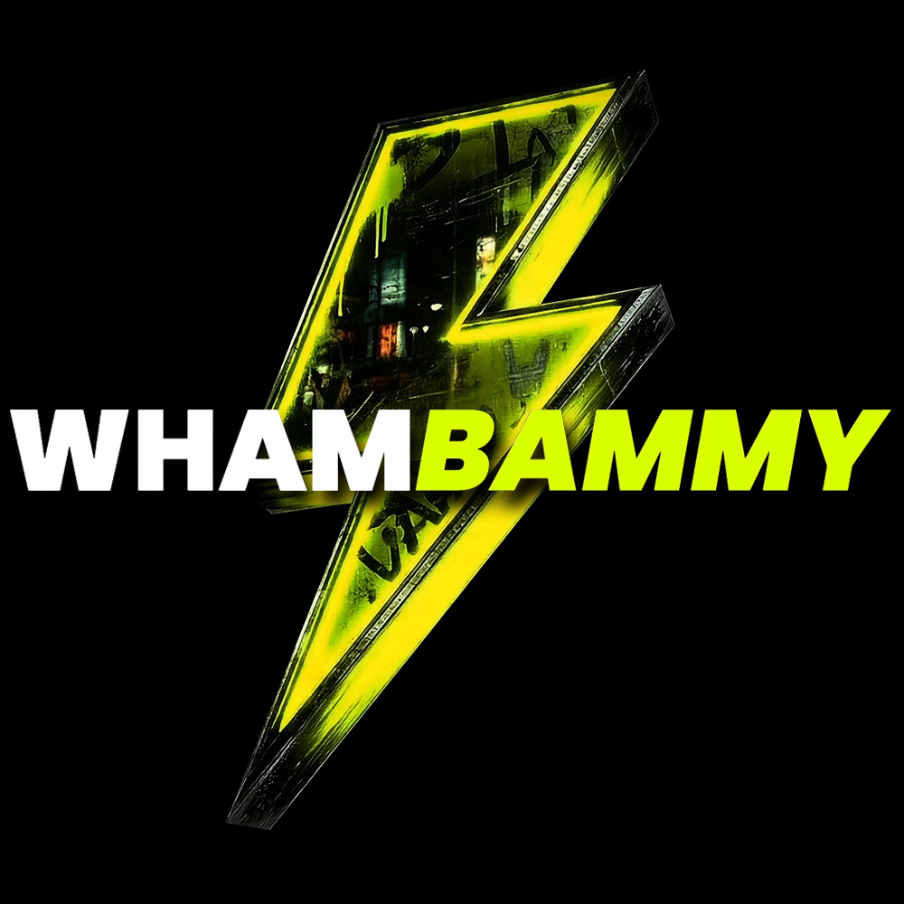

<p align="center">
  
</p>

# Robotics & Spatial Vision MCP

[](https://smithery.ai)
[](https://modelcontextprotocol.io)
[](https://base.org)
[](#included-tools)
[](LICENSE)

**Point cloud ICP alignment, Recast navmesh baking, robot arm inverse kinematics, and LIDAR ground plane filtering for physical AI agents.**

Built specifically for Robotics engineers, ROS developers, autonomous drone/robot navigation, and spatial vision agents.

---

## ⚡ Quickstart

### Smithery Install
```bash
smithery skill add whambammy/robotics-spatial-vision-mcp
```

### Claude Desktop / Cursor (`claude_desktop_config.json`)
```json
{
  "mcpServers": {
    "robotics-spatial-vision-mcp": {
      "command": "npx",
      "args": ["-y", "@whambammy/robotics-spatial-vision-mcp"],
      "env": {
        "PAYMENT_WALLET": "0x9793E7269b3301893318dEa8338576Ba612F39B3",
        "BASE_RPC_URL": "https://mainnet.base.org"
      }
    }
  }
}
```

---

## 🛠️ Included Tools

| Tool Name | Price (USDC) | Capability |
| :--- | :---: | :--- |
| `pointcloud_icp_rigid_registration` | $0.045 | Iterative Closest Point (ICP) algorithm aligning two unorganized 3D point clouds with robust Tukey loss weighting to filter noisy scan outliers. |
| `navmesh_recast_baking_validator` | $0.040 | Generates and audits Recast 3D navigation meshes for autonomous agents, checking maximum slope climbing, step-height clearance, and unreachable islands. |
| `robot_arm_inverse_kinematics_ccd` | $0.040 | Cyclic Coordinate Descent (CCD) and FABRIK solver computing 6-DOF robotic manipulator joint angles with strict joint-angle limit enforcement. |
| `lidar_ground_plane_ransac_filter` | $0.035 | RANSAC plane segmentation isolating ground terrain from foreground obstacles and vehicles in dense unorganized LIDAR point clouds. |
| `camera_intrinsics_projection_matrix` | $0.020 | Computes 4x4 perspective and orthographic camera projection matrices, mapping FOV, focal length, sensor dimensions, and near/far clipping planes. |


---

## 🔄 End-to-End Workflow

A robotics agent receives multi-sensor LIDAR and camera frames -> runs RANSAC ground plane segmentation -> aligns point clouds using ICP -> computes inverse kinematics to reach an obstacle-free target on a validated Recast navigation mesh.

---

## 💰 The x402 Base L2 Micropayment Protocol

When an agent invokes a tool without payment, the server responds with a deterministic `HTTP 402 Payment Required` challenge containing:
- Target tool price in USDC
- Base Native USDC Contract: `0x833589fCD6eDb6E08f4c7C32D4f71b54bdA02913`
- Recipient payout wallet address
- Single-use cryptographic nonce

Once broadcasted on Base L2, resubmitting with `paymentSignature` unlocks deterministic execution.

---

## 📄 License
MIT License. Created by [Whambammy](https://github.com/Whambammy).
